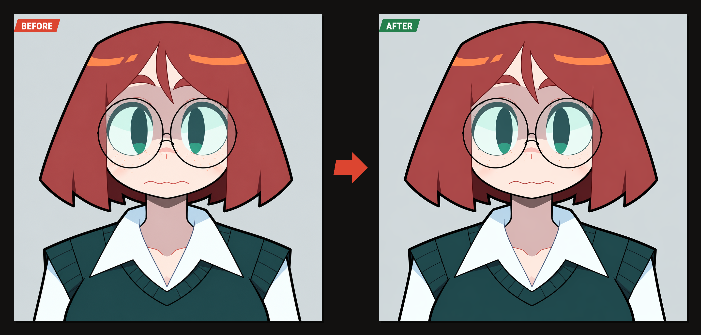
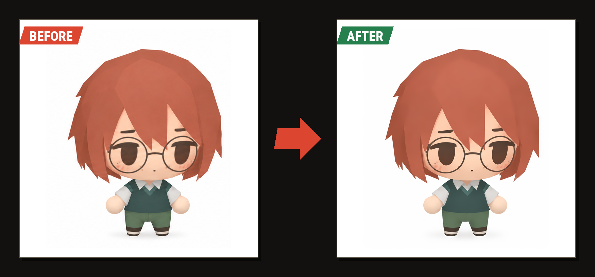
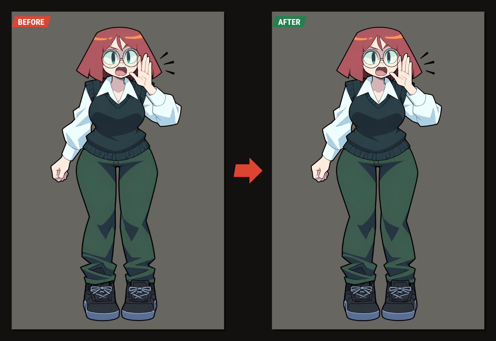
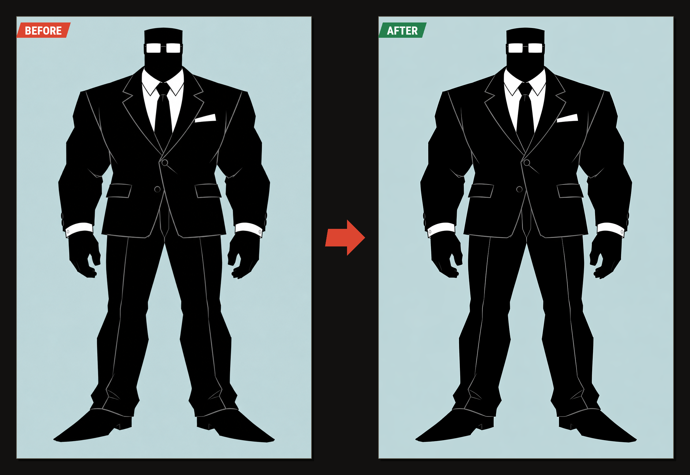
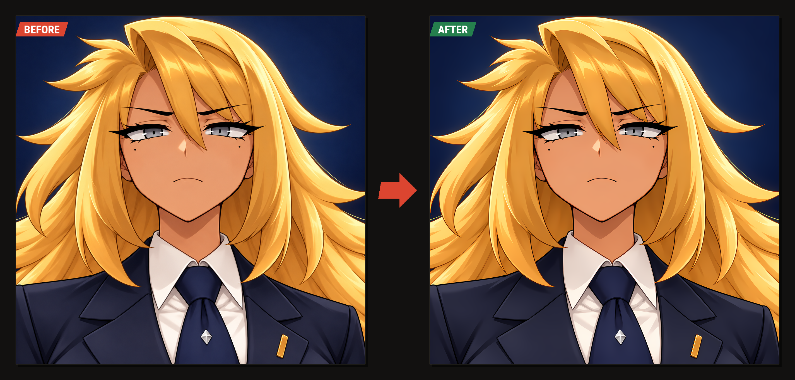
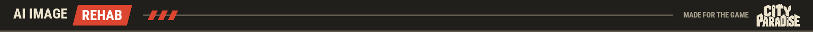

# AI Image Rehab

**Takes the AI look off a drawing.**

A picture from an image generator carries a trace: a pale or dark strip along every line, blotches
and grain in the flat fills. The eye reads it as "dirty" and "this is AI", most of all from afar.
AI Image Rehab removes that trace **without redrawing the picture**: lines, shadows and small
details stay where they are.

Everything runs on your own computer. The picture is sent nowhere.

Click a sheet to see it at full size: the trace is a matter of single pixels.






A picture with soft shading is cleaned gently, so that its painted detail is not taken for dirt:





## What it does

| | |
| --- | --- |
| **Remove ripple** | One button for the whole picture. No neural network and no video card: plain image maths, 5 to 20 seconds. |
| **Double the size** | Optional. An anime upscaling network draws the lines sharp at twice the size. A flat-colour picture keeps its own colours and its small details (freckles, blush). |
| **Fix by hand** | For what the generator drew wrongly. Brush over a stray stroke and the spot is redrawn from what is around it; brush where an outline is missing and it is drawn. Only what is under the selection changes, and every step can be undone. |

## Quick start

You need Python (made and tested with 3.12). Download or clone this repository and run in its
folder:

```bash
pip install -r requirements.txt
python app/ripple_studio.py --open
```

The page opens at <http://127.0.0.1:4390>. On Windows `run.cmd` does the second step, elsewhere
`run.sh`.

That is all **Remove ripple** needs. The two tools that use a neural network (redrawing a spot and
doubling the size) need PyTorch and two model files, 213 MB together:

```bash
pip install torch
python get_models.py
```

Until then the page works without them and says so. The network that redraws a spot runs on the
processor, two or three seconds a spot. Doubling a 1024 x 1536 picture took 40 seconds with a video
card (CUDA) and about two minutes on the processor alone.

## The page

1. **Picture.** Open a file, drop it onto the page, or paste it from the clipboard. The source file
   is never changed. "From folder" shows the three pictures in `examples/`, to try the page at
   once; start it with `--dir FOLDER` and the button shows that folder of yours instead.
2. **Auto clean.** Choose "Flat colour" or "Soft shading" and press "Remove ripple". Hold "Before"
   to compare.
3. **Fix by hand**, if anything is left. Choose what to do, select the spot, press the button.
   `Ctrl+Z` undoes a step and gives the selection back.
4. **Done.** Download the PNG. A picture with see-through parts keeps them.

The page has a dark and a light look (the button in its header). The work is written to disk after
every step and taken up again when the page is started.

## Command line

```bash
python app/deripple.py OUT_DIR picture.png [--painted] [--diff]    # clean pictures
python app/ripple_check.py picture.png                              # measure the ripple
python app/retouch.py in.png out.png --brush "x,y x,y" [--keep shapes|lines|nothing] [--draw]
python app/neural_fill.py in.png out.png --brush "x,y x,y"          # redraw a spot with the network
```

Every script explains itself with `--help`.

## How it works, briefly

- **Auto clean** splits the picture into calm fills and edges. Inside a fill, a pixel that differs
  from the mean of its fill by less than 5 brightness levels is dirt and is evened out; a
  difference over 10 is drawing (a shadow, blush, a highlight) and is left alone. Beside a line,
  the strip that is lighter or darker than the fill is pulled to the fill's colour. No shape moves.
- **Removing a mark** uses LaMa trained on anime and manga. The spot is shown to it twice larger
  than it is (it fills better so), and the plain fills of its answer are then drawn with the exact
  colours of the picture itself, so there is neither a colour shift nor grain.
- **Doubling** uses Real-ESRGAN for anime. On a flat-colour picture only the sharpness of lines is
  taken from the network; the colours and everything inside a calm fill stay the picture's own.

## What it cannot do

It invents nothing: it will not add a lash or mend a finger. A network draws what is likely, not
what is true, so look at every result. It was made and tuned on anime-style character art; other
kinds of pictures were not tried. It was made and run on Windows.

## Optional: a big model of your own

If you have Forge, or another installation with `torch`, `diffusers`, `transformers` and an SDXL
anime checkpoint, the page gets one more way of removing a mark, "Refined": after the fast network
that model draws the spot clean (20 to 60 seconds, on the video card). Nothing is written into that
installation. Name three things before starting the page, for example on Windows:

```bat
set FILL_PYTHON=D:\Forge\venv\Scripts\python.exe
set FILL_CHECKPOINT=D:\Forge\models\Stable-diffusion\your-sdxl-anime-model.safetensors
set FILL_SETUP=D:\Forge\backend\huggingface\stabilityai\stable-diffusion-xl-base-1.0
```

`FILL_SETUP` is a folder with the SDXL layout files (`model_index.json` and its subfolders).


## Credits

- [LaMa](https://github.com/advimman/lama) by Suvorov et al.; the anime and manga weights are the
  ones published with [IOPaint](https://github.com/Sanster/IOPaint).
- [Real-ESRGAN](https://github.com/xinntao/Real-ESRGAN) by Xintao Wang et al.
- Roboto Condensed, under the Open Font License (`app/studio/OFL.txt`).
- Made for the game **City Paradise**.

## License

[MIT](LICENSE) for the code of this repository. The model files are not part of it:
`get_models.py` downloads them from their authors' releases, and each comes under its author's own
terms.
